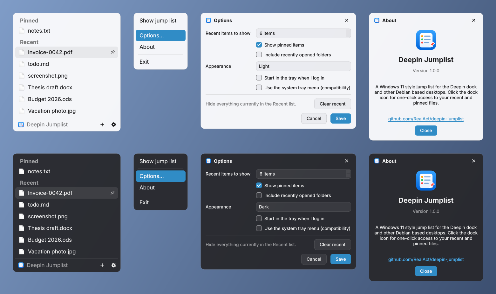
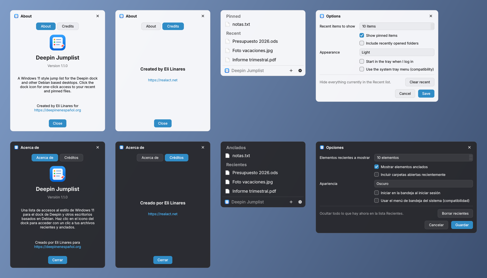

# Deepin Jumplist

A Windows 11 style jump list for the Deepin Desktop Environment and other
Debian based Linux distributions.

Click the app's icon on the dock and a rounded list pops up with your most
recently opened files (photos, documents, text files, PDFs, spreadsheets,
anything) plus the files you pinned. Click an entry and it opens in its
default application.



## Features

- **Recent items** read from the freedesktop `recently-used.xbel` list, which
  the Deepin file manager, Deepin apps, GTK apps, LibreOffice and most Qt apps
  write to. Missing files are skipped automatically.
- **Recent folders** (optional, turn on in Options): folders you used
  recently, worked out from the folders that hold your recent files, since
  most apps only record files.
- **Pinned items** at the top of the list. Hover a row and click the pin, use
  the right-click menu, or press **+** in the footer to pin any file.
  Pinned items can be reordered from the right-click menu.
- **One click opens the file** in its default application (same as
  `xdg-open`). Rows can also be dragged into other apps.
- **Right-click menu** on each row: Open, Open file location, Copy path,
  Pin/Unpin, Move up/down, Remove from this list.
- **Tray icon**: left click toggles the jump list, right click opens a rounded
  menu with *Show jump list*, *Options…*, *About* and *Exit*.
- **Options window**: number of recent items (1 to 30), show or hide pinned
  items, show recent folders, light/dark/system appearance, start at login,
  and *Clear recent*.
- **Rounded corners everywhere**: the jump list, the tray menu, the right-click
  menu, and the Options and About windows. When no compositor is running the
  corners are cut with a window mask instead of transparency.
- Keyboard: arrow keys to move, Enter to open, Esc to close, Menu key for the
  context menu.
- The dock's own right-click menu gets *Options* and *About* entries too.
- **About window** with two tabs, *About* and *Credits*.
- **English and Spanish.** The app shows in Spanish when the system language
  is Spanish (any `es_*` locale, taken from `LANGUAGE`, `LC_ALL`,
  `LC_MESSAGES` or `LANG`), and in English otherwise. Translations live in
  `deepin_jumplist/i18n.py`.



## Install

### Requirements

```sh
sudo apt install python3-pyqt5 libqt5svg5
# optional, lets the app detect when no compositor is running:
sudo apt install python3-pyqt5.qtx11extras
```

### Option 1: per-user install (no root)

```sh
git clone https://github.com/RealAct/deepin-jumplist.git
cd deepin-jumplist
./install.sh
```

This copies the app to `~/.local/share/deepin-jumplist`, the launcher to
`~/.local/bin/deepin-jumplist`, and the menu entry and icon into
`~/.local/share`. Use `sudo ./install.sh --system` to install into
`/usr/local` for all users. `./uninstall.sh` (or `sudo ./uninstall.sh --system`)
removes it again.

### Option 2: build a .deb

```sh
./packaging/build-deb.sh
sudo apt install ./dist/deepin-jumplist_1.1.1_all.deb
```

### Put it on the dock

Open the Launcher, find **Deepin Jumplist**, right-click it and choose
**Send to dock** (on GNOME based desktops: *Add to Favorites*). From then on,
clicking the dock icon opens and closes the jump list.

To have the tray icon from the moment you log in, tick
*Start in the tray when I log in* in Options.

## How it works

The dock starts the app's `.desktop` command on every click. The first launch
starts the app (tray icon + popup). Every later launch passes a "toggle"
message to the running instance through a local socket in
`$XDG_RUNTIME_DIR` and exits in about 50 ms, so the list appears instantly.
If the list was open, the click on the dock both closes it and starts the
toggle; the app notices that and keeps it closed.

Command line:

```
deepin-jumplist              toggle the jump list (starts the app if needed)
deepin-jumplist --background start in the tray only
deepin-jumplist --options    open Options
deepin-jumplist --about      open About
deepin-jumplist --quit       exit the running instance
```

Settings and pins are stored in `~/.config/deepin-jumplist/config.json`.

## Notes and limits

- Only files that apps report to `recently-used.xbel` can appear. Nearly all
  desktop apps do; some sandboxed (Flatpak/Snap) apps or terminal tools do not.
  The Deepin file manager records files you open from it.
- On GNOME, a tray icon needs the *AppIndicator and KStatusNotifierItem
  Support* extension. If right-clicking the tray icon shows nothing on your
  panel, tick *Use the system tray menu (compatibility)* in Options.
- Image rows use the thumbnail from `~/.cache/thumbnails` when one exists,
  otherwise the icon theme's icon for the file type.

## Development

```sh
python3 -m deepin_jumplist      # run from the source tree
python3 -m pytest               # unit tests (no display needed)
```

The code lives in `deepin_jumplist/`: `recent.py` (xbel parser), `config.py`
(settings and pins), `popup.py` (the jump list), `dialogs.py` (Options and
About), `theme.py` (colours and rounded-corner helpers) and `app.py`
(single instance, tray icon).
